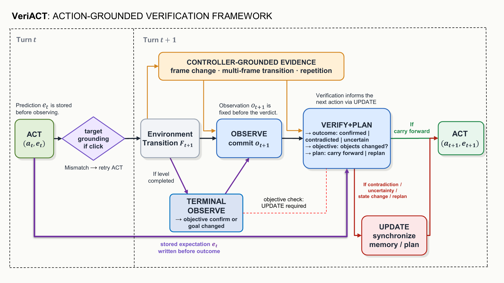
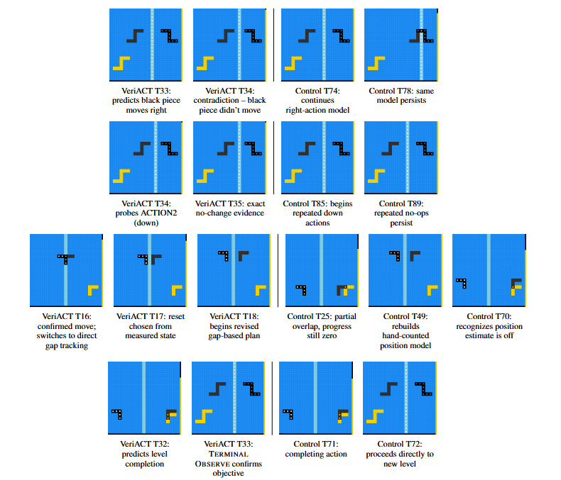

# VeriACT: Action-Grounded Verification for Efficient Interactive Visual Reasoning

Code for the paper **VeriACT: Action-Grounded Verification for Efficient Interactive Visual
Reasoning** (Dung Dinh Tran, Yu-Wing Tai — Dartmouth College). The paper is in
[`report/paper.pdf`](report/paper.pdf).

VeriACT is a task-agnostic agent harness for [ARC-AGI-3](https://arcprize.org/arc-agi/3), an
interactive benchmark where an agent is dropped into an unfamiliar turn-based game with no rules,
no goal and no instructions, and has to work out how it plays from the frames it gets back. A
vision-language model makes the decisions; the harness runs the game loop, renders frames, keeps
the agent's notes and context, and logs everything.

VeriACT's idea is to make verification a **required step of the loop**. Every action has to come
with a falsifiable expectation of what the next frame will look like. Before the next action, the
agent has to say what it observes, judge that expectation against the actual transition, and update
its notes or replan when the evidence calls for it:

```
OBSERVE  →  VERIFY+PLAN  →  [UPDATE]  →  ACT
```



*The VeriACT cycle across two turns.*

- **Turn t:** the agent commits an action together with its expectation, (a<sub>t</sub>,
  e<sub>t</sub>). A click is checked against its intended target before it is sent.
- **Turn t+1:**
  1. The model first commits its observation of the new frame (OBSERVE).
  2. VERIFY+PLAN then judges e<sub>t</sub> against that observation, together with evidence
     the harness computes itself: frame change, multi-frame transitions and repetition.
  3. A contradiction, uncertainty, a state change or a replan sends the agent through UPDATE
     before it may act again.
  4. A level-completing transition first goes through TERMINAL OBSERVE, which checks the inferred
     objective.

The repository contains both arms of the paper's comparison:

| Folder | What it is |
|---|---|
| [`veriact/`](veriact/) | **VeriACT**, the staged, controller-enforced verification loop. |
| [`baseline/`](baseline/) | **The free-form control**: one model exchange per turn, with the same tools. |

Both arms use the same model, rendering, notes, evidence tools and context management. They differ
only in how the controller structures each turn.

## Results

13 ARC-AGI-3 games with `Qwen/Qwen3.8-27B`. Both arms use the same model, sampling settings,
budgets and stopping rules, and each run is capped at 300 turns. Details are in §4 of the paper.

| | Control | VeriACT |
|---|---|---|
| Mean per-game RHAE | 1.72 | **6.36** |
| Levels completed (total) | 9 | **14** |
| Actions on the 5 levels both completed | 156 | **104** (−33.3%) |
| Tokens on those 5 levels | **15.12M** | 34.67M (2.29×) |

VeriACT spends more inference compute in order to make more progress with fewer environment
actions. On the five levels both arms completed (Level 1 of ar25, cn04, lp85, re86 and s5i5),
VeriACT used fewer actions on four and tied on the fifth.

<details>
<summary><b>Per-game results (click to expand)</b></summary>

| Game | RHAE Control | RHAE VeriACT | Actions/level Human | Actions/level Control | Actions/level VeriACT |
|---|---:|---:|---:|---:|---:|
| ar25 | 0.56 | 8.33 | **32**/50 | 71 | **32**/**29** |
| cd82 | 0.00 | 4.76 | 55 | – | **46** |
| cn04 | 4.76 | 4.76 | 29 | 22 | **21** |
| dc22 | 2.80 | 0.00 | **59** | 77 | – |
| ft09 | 0.00 | 47.62 | 43/12/23/**28** | – | **6**/**7**/**14**/30 |
| lp85 | 2.78 | 2.78 | 17 | **7** | **7** |
| m0r0 | 0.57 | 0.00 | **30** | 87 | – |
| re86 | 7.92 | 2.78 | 26/42 | 35/**38** | **25** |
| s5i5 | 2.52 | 2.78 | 20 | 21 | **19** |
| sk48 | 0.00 | 0.00 | **61** | – | – |
| sp80 | 0.50 | 0.00 | **39** | 120 | – |
| su15 | 0.00 | 2.22 | 22 | – | **20** |
| tu93 | 0.00 | 6.67 | **19**/16 | – | 22/**15** |
| **Mean** | **1.72** | **6.36** | | | |

How to read the table:

- **Actions/level:** slash-separated values are successive completed levels. Each arm lists only
  the levels it completed, and "–" means it completed none.
- **Human:** the ARC-AGI-3 reference action counts (`baseline_actions`), shown up to the deepest
  level either arm reached.
- **Bold:** the lowest action count for that level, with ties bolded together.

The largest gains are on ft09, ar25 and tu93. On these games VeriACT gets past levels the control
never completes, so the benefit is not only fewer redundant actions on levels already solved.
VeriACT is not better everywhere: it scores lower on re86, and it completes nothing on dc22, m0r0
and sp80, which the control each clears one level of.

</details>

<details>
<summary><b>Qualitative example: ar25 (click to expand)</b></summary>

In ar25 the agent has to line up the gray reflection of a movable piece with a yellow target across
a light-blue axis. Levels 1–2 show the four ways verification changes what the agent does next
(paper §4.3):



*VeriACT on the left of each row, the free-form control on the right. Rows follow the four cases
below, top to bottom.*

1. **Falsifying an inherited action model.** At the start of Level 2, VeriACT assumes the
   directional actions move the black piece.
   - At T33 it plays `ACTION4`, expecting the black piece to move right. Instead, the black piece
     stays put while the central band and the gray piece move.
   - At T34, VERIFY+PLAN flags the contradiction and replans on the assumption that the band is
     what moves.
   - The control meets the same mismatch at T74 and is still using the wrong model at T78.
2. **Ending an ineffective probe.** VeriACT probes `ACTION2` (down) at T34 and gets back a
   pixel-identical frame.
   - At T35 the harness reports that the frame did not change.
   - VERIFY+PLAN marks the expectation contradicted, and the agent switches strategy.
   - The control starts a run of downward actions at T85. They still do nothing by T89, five moves
     later, when it reaches the same conclusion.
3. **Revising state and plan.** On Level 1, VeriACT's move at T16 is confirmed. Its state check,
   however, finds that the position it has worked out by counting moves disagrees with the
   measured one.
   - It switches to measuring the remaining gap directly.
   - At T17 it resets, because the measured state shows a shorter path.
   - From T18 it follows the revised plan to completion.
   - The control keeps counting moves:
     - T25: a partial overlap, with no progress.
     - T49: it rebuilds its hand-counted position model.
     - T70: it finally recognises that its position estimate is wrong.
4. **Verifying the objective at a level boundary.** At T32, VeriACT predicts that overlapping the
   gray reflection with the yellow target will complete Level 1, and it does. At T33, TERMINAL
   OBSERVE examines the completing transition and records the overlap as the objective, before
   the Level 2 layout is processed. The control completes the level at T71 and at T72 goes
   straight on to the new level without an equivalent check.

In each case VeriACT makes the same initial mistake as the control. The difference is that the
evidence from the mistake is used before the next action is chosen.

</details>

## How it works

### What the model sees, in both arms

- **The observation is an image.** Each 64×64 frame is rendered as a 512×512 PNG. Every cell is
  outlined in its own colour at 75% brightness. The model gets no text grid and is never told the
  grid size, the cell size or the colour numbering.
- **The turn message** gives only interface facts: turn number, available actions, levels
  completed, and game state.
- **The tools:**
  - `play` takes one game action. It requires an `expectation`, and the click action `ACTION6`
    takes image-pixel `x`/`y`.
  - `read_notes` / `write_notes` work on two notes files, `GUIDE.md` and `WORKING.md`.
  - `inspect` re-views archived frames, optionally cropped.
  - `read_pixels` resamples a region of a frame into a grid of colour symbols.
  - `history` gives a text summary of past attempts and actions.
- **Context management** (`memory/session.py`) makes no model call. When the context fills up, it
  first drops `inspect` images, then replaces older frames with a placeholder saying how to
  retrieve them, then folds the oldest turns into a digest built mechanically from the trace.
  Recent turns always stay verbatim.
- **The harness is task-agnostic.** There is no game-specific code, and the game id is only a
  runtime argument.

### The baseline (`baseline/`)

Each turn is one model exchange. The model may call any tool freely and ends the turn with `play`.

### VeriACT (`veriact/`)

Each turn is a sequence of stages. Each stage must end with its own terminal tool call, and ACT
cannot be reached until the earlier stages are done:

| Stage | Tools | Ends with |
|---|---|---|
| TERMINAL OBSERVE (only after a level completes) | read-only | `observe` + `objective_reconfirmed`, `goal_changed` |
| OBSERVE | read-only | `observe(description)` |
| VERIFY+PLAN | all but `play` | `verify_and_plan(verdict, evidence, observation_check, objects_changed, mode, plan, …)` |
| UPDATE (only when required) | `write_notes` | `write_notes(…)` |
| ACT | read-only, plus `write_notes` restricted to `WORKING.md` | `play(action, expectation[, x, y, target_description])` |

- **When UPDATE runs:** the verdict is not `confirmed`, the plan is replaced, objects changed, a
  level ended, the game is over, or the goal changed.
- **Controller-grounded evidence**, which the harness computes and states as facts in the next
  turn's message:
  - whether the last action changed the frame (checked across every animation frame);
  - repeated or alternating actions;
  - a note when an action returned several frames;
  - a click-mismatch note when a click could not be confirmed.
- **Click-target confirmation:** before a click is sent, a separate request shows the model a crop
  around the target and asks whether it matches the `target_description`. If it doesn't, the click
  is rejected and retried.

## Repository layout

```
baseline/  veriact/          one self-contained package per arm, with the same internal layout:
  agent/                     run.py (CLI), loop.py (turn loop), tools.py (schemas + validation),
                             env.py (SDK adapter + frame archive), llm.py (chat client), config.py
                             (veriact also has memo.py, a plain-text fallback for unreliable tool calling)
  perception/                observation.py (rendering, crops, pixel resampling), render.py (prompts)
  memory/                    memory.py (notes), session.py (context window), digest.py, stagnation.py
  evaluation/                eval.py (batch CLI), scoring.py (RHAE), tracelog.py (trace.jsonl)
  prompts/                   every model-facing string; manifest.yaml lists the parts
  config/default.yaml        all settings for that arm
scripts/
  download_all_environments.py   fetch the ARC-AGI-3 games (needs an ARC API key)
  check_prompts.py               validate both prompt sets
  serve/                         vLLM launch scripts
replay_viewer/               turn a run directory into a self-contained HTML replay (see replay.md)
assets/                      figures used in this README
report/paper.pdf
```

## Setup

### 1. Install

Python 3.12 or newer is required (needed by `arc-agi`).

```bash
pip install -r requirements.txt
```

This installs `arc-agi==0.9.8`, `arcengine==0.9.3`, `numpy`, `openai`, `Pillow` and `PyYAML`.

### 2. Download the games

The game environments are not included here. Get an API key from
[arcprize.org](https://arcprize.org), then run:

```bash
export ARC_API_KEY=...            # or put ARC_API_KEY=... in a .env file
python scripts/download_all_environments.py
```

This writes `environment_files/<game>/<version>/` at the repository root, which is where both
harnesses look by default. Use `--environments-dir` to point elsewhere. Once downloaded, games run
fully offline.

### 3. Serve a model

The harness talks to any OpenAI-compatible chat-completions endpoint with tool calling and image
input. For the paper we served `Qwen/Qwen3.8-27B` with vLLM:

```bash
NUM_GPUS=4 bash scripts/serve/serve_qwen3.8_27b.sh     # serves on port 8000
```

The script installs `vllm>=0.17.0` if it is missing (the paper used vLLM v0.19.1). It enables
`--reasoning-parser qwen3` and `--tool-call-parser qwen3_coder`, and caps images per request at 128
(`MM_IMAGE_LIMIT`). Other settings (`PORT`, `MAX_MODEL_LEN`, `GPU_MEM_UTIL`, `VLLM_API_KEY`, …) are
documented in the script's header.

The `model:` block of each `config/default.yaml` must match the server: `base_url`, `model`, and
`max_context_tokens` (= `--max-model-len`). If the server was started with `VLLM_API_KEY`, export
the same variable for the harness.

## Running

Run all commands from the repository root. Pick an arm by choosing the package.

**Play one game:**

```bash
python -m veriact.agent.run  --game ls20
python -m baseline.agent.run --game ls20
```

**Run and score a batch:**

```bash
python -m veriact.evaluation.eval --games ar25,cn04 --runs-dir runs/veriact
python -m veriact.evaluation.eval --all-games        --runs-dir runs/veriact
```

This prints a per-game table (levels completed, actions used, baseline actions, score) and writes
`<runs-dir>/eval_summary.json`.

**Reproduce the paper's comparison** (13 games, 300 turns per run, which is the default):

```bash
GAMES=ar25,cd82,cn04,dc22,ft09,lp85,m0r0,re86,s5i5,sp80,sk48,su15,tu93
python -m veriact.evaluation.eval  --games $GAMES --runs-dir runs/veriact
python -m baseline.evaluation.eval --games $GAMES --runs-dir runs/baseline
```

Sampling is stochastic (temperature 1.0), so individual runs will not match the paper exactly.

Common flags for both commands:
- `--config override.yaml` deep-merges a YAML file over `config/default.yaml`.
- `--max-turns N` caps the number of turns.
- `--environments-dir PATH` says where the games are.

### Configuration

Everything is set in `<arm>/config/default.yaml`, which is commented throughout. The settings used
in the paper are the shipped defaults. The main groups:

- **`model`:** endpoint, model id, context size, sampling (`temperature: 1.0`, `top_p: 0.95`,
  `max_output_tokens: 32768`, `reasoning_effort: xhigh`).
- **`run`:** stopping rules.
  - `max_turns: 300`.
  - A per-level action budget of `baseline_actions × action_budget_multiplier` (5).
  - `max_resets_per_level` and `max_total_actions`.
  - Per-turn tool-call limits: 12 for the baseline. For VeriACT, 6 in ACT and 30 in each other
    stage.
- **`session`:** context-management thresholds and image budgets.
- **`trace`:** `log_thinking` and `log_raw_response`, for extra logging.

A run stops on `WIN`, on a `RESET` that fails to recover from `GAME_OVER`, or when a budget runs
out. `GAME_OVER` alone does not stop a run, because the model can `RESET`.

## Outputs

Each run writes `runs/<game>-<id>/`:

| File | Contents |
|---|---|
| `trace.jsonl` | One record per turn: the turn message, the model output, every tool call, the action, the expectation and the reported change, token counts, and (VeriACT) each stage's result. Cut events are interleaved as `{"event": "cut", ...}`. |
| `run_summary.json` | Why the run stopped (`stop_reason`), plus turn and action counts. |
| `frames/` | Every returned frame as a PNG, with `manifest.json`. |
| `frame_store.npz` | The raw integer grids. |
| `GUIDE.md`, `WORKING.md`, `working/level_<n>.md` | The agent's notes, and `WORKING.md` as it stood at the end of each level. |

`trace.jsonl` is self-sufficient. `evaluation/scoring.py` (`levels_from_trace`,
`environment_score`) recomputes the official ARC-AGI-3 score from it offline, and
`memory/digest.py` (`facts_from_trace`) rebuilds the context digests the model was shown. The
scoring replicates `arc_agi.scorecard`'s formula: per level `min((baseline/actions)² × 100, 115)`,
averaged with weights equal to the level number.

To browse a run in a browser:

```bash
pip install -r replay_viewer/requirements.txt
python replay_viewer/build_replay.py runs/<game>-<id>     # writes runs/<game>-<id>_replay.html
```

See [`replay.md`](replay.md) for the viewer's options.

## Development notes

- Every model-facing string is in `<arm>/prompts/`. Tool descriptions are prompt files, not
  docstrings. After editing a prompt, run `python scripts/check_prompts.py`. It checks variables
  and referenced files, that the always-sent prompts don't give away the grid structure, and that
  no prompt names the test games (`ls20`, `vc33`).
- `veriact/agent/loop.py` and `baseline/agent/loop.py` each start with a docstring describing their
  turn structure in full.

## Citation

```bibtex
@misc{tran2026veriact,
  title  = {VeriACT: Action-Grounded Verification for Efficient Interactive Visual Reasoning},
  author = {Tran, Dung Dinh and Tai, Yu-Wing},
  year   = {2026}
}
```

## Acknowledgements

ARC-AGI-3 and its SDK are by the [ARC Prize Foundation](https://arcprize.org). The baseline's
observation format and tool set follow [VISTA](https://vista-research.github.io/) (Han et al.,
2026), reimplemented here as a standalone harness.
